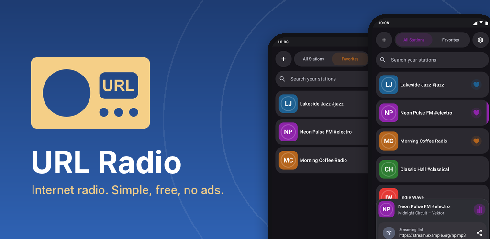
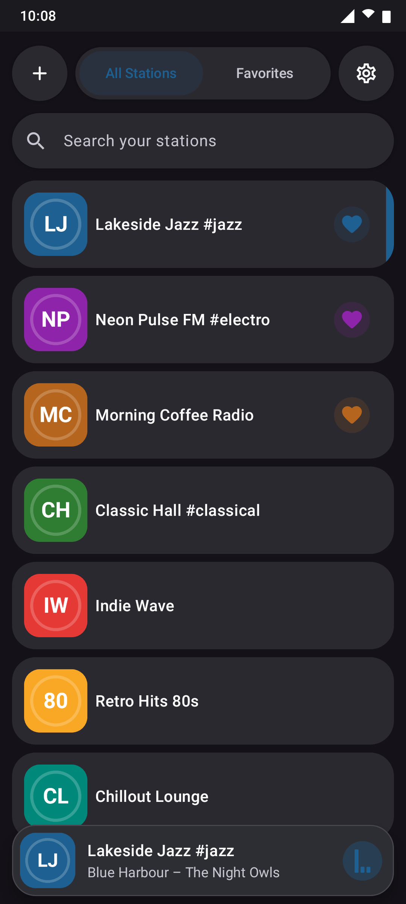
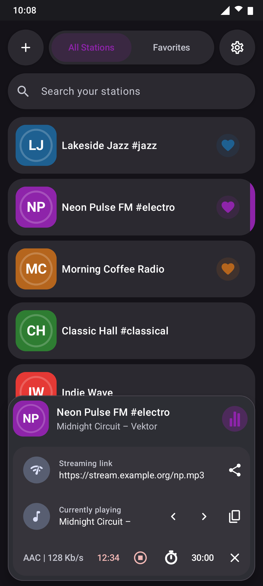
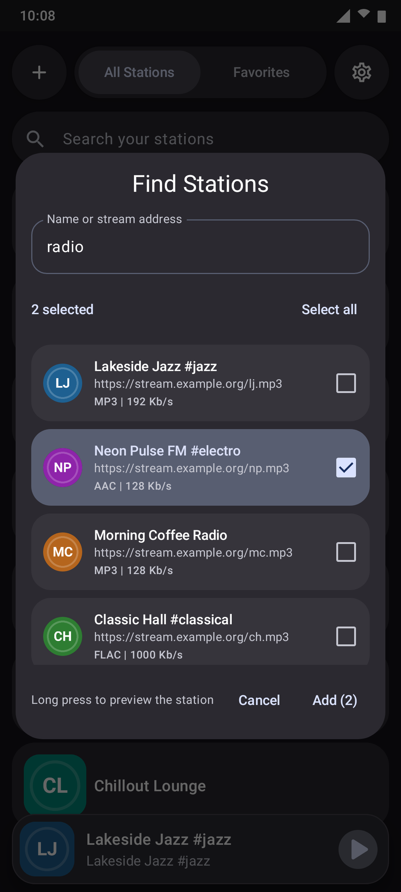
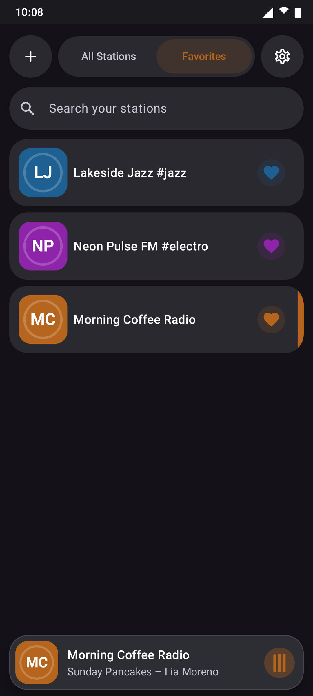
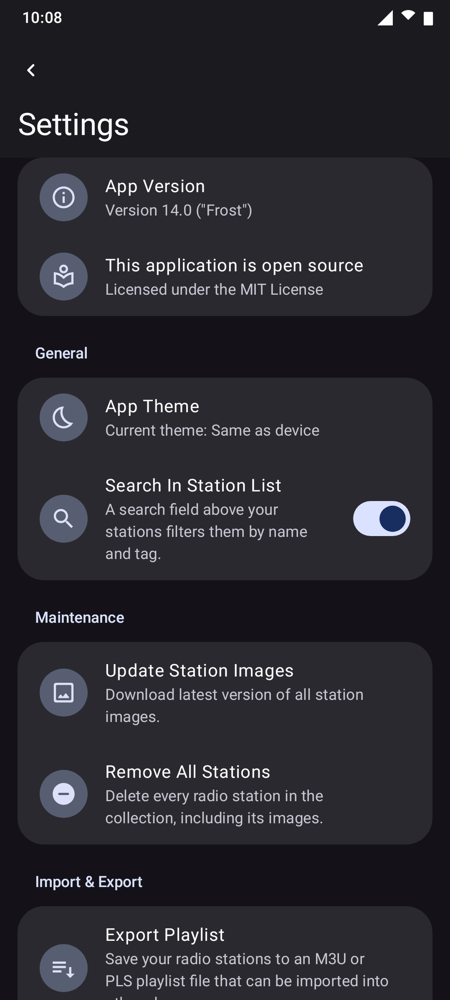
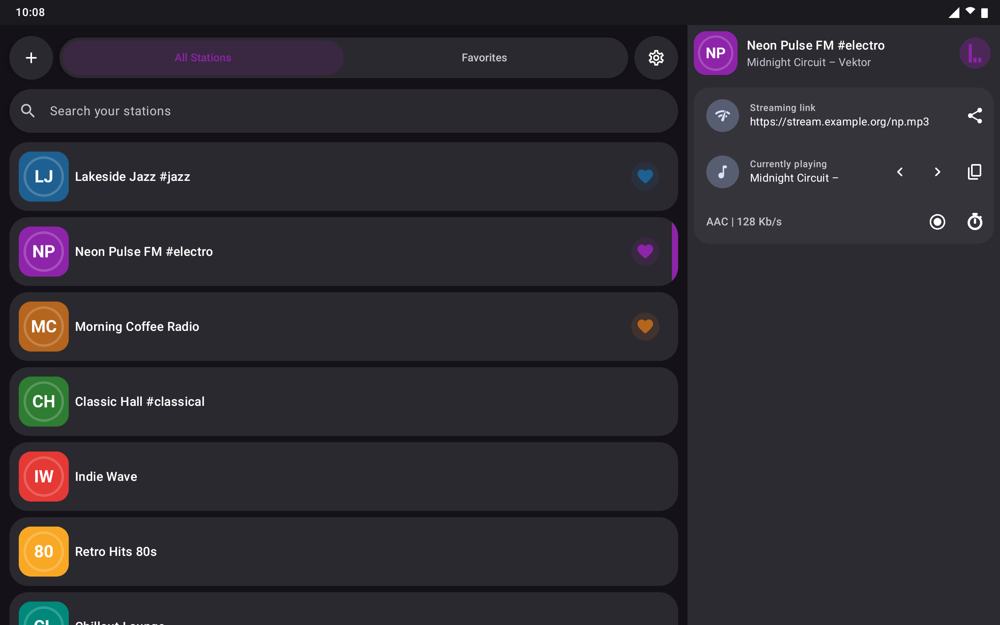
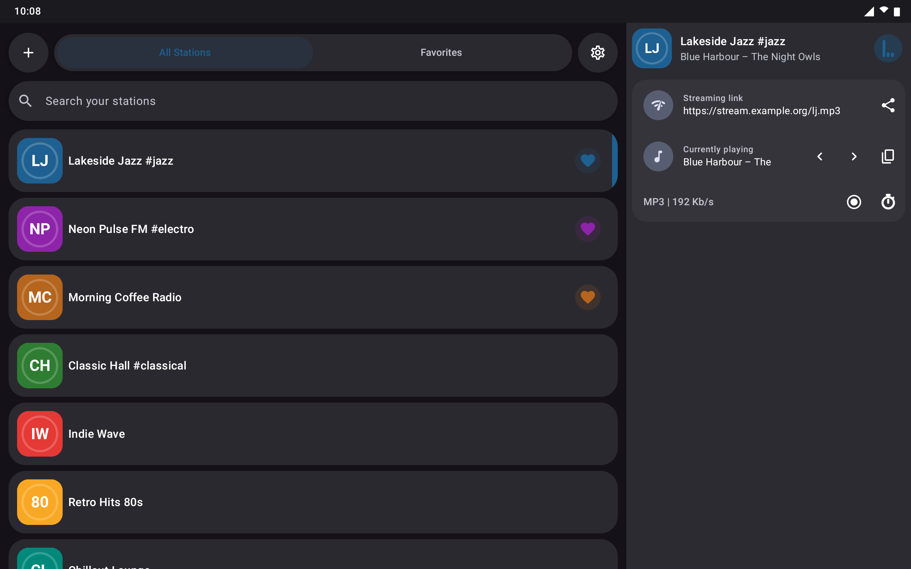

### ℹ️ About URL Radio
**URL Radio is a fork from Transistor.**  
**URL Radio is an application with a minimalist approach to listening to radio over the Internet.**  
**Find stations in the [radio-browser.info](https://www.radio-browser.info/) database, add them from M3U / PLS playlists, or simply tap a stream link in your web browser.**  
**Pull requests are welcome at any time.** 

**URL Radio is free software. It is released under the [MIT open source license](https://opensource.org/licenses/MIT).**

----------------------------------------

⚙️ Install URL Radio

 

----------------------------------------

✨ Features

 

**Listening**
- Plays MP3, AAC, Ogg (Vorbis / Opus), FLAC and HLS streams
- Shows the current song – for Icecast / Shoutcast, HLS and Ogg streams
- Sleep timer
- Home screen widget with station, current song and play / stop
- Quick settings tile to switch the radio on and off
- Android Auto and voice commands ("Play … on URL Radio")

**Recording**
- Record what is playing with one tap, or long-press for a recording with a timer
- AAC (.m4a), Opus (.ogg, Android 10+) or lossless WAV, bit rate selectable in the settings
- Recordings are saved to `Music/URL Radio` (Android 10+) or the app's own music folder

**Finding and organising stations**
- Search radio-browser.info: the most listened-to stations first, with logo and listener count
- Add stations from M3U / M3U8 / PLS playlists – station logos (`tvg-logo`) included
- Add a raw stream address – name and bit rate are taken from the stream
- Set a station logo from the gallery or from a web address
- Favourites, tags (`#jazz` in the station name) and an optional search in your station list
- Export your stations as M3U / PLS, back them up and restore them

----------------------------------------

📸 Screenshots

 

**Phone**

**Tablet**

----------------------------------------

🚗 Enable URL Radio in Android Auto

 
It is possible to use URL Radio on Android Auto if you have enabled unknown sources in Android Auto developer settings.

To enable:
- Go to Android Auto settings and tap Version about 10 times to enable developer settings.
- Tap on the hamburger menu on the top right and tap on Developer Settings.
- Enable unknown sources.

URL Radio should be available in Android Auto the next time you launch it.

----------------------------------------

💡 Frequent Questions

Q: How can I add a radio station?  
A: Tap the + button. There you can search radio-browser.info, enter the address of a playlist (M3U, M3U8, PLS) or enter a raw stream address. You can also import a playlist file under Settings, or tap a stream link in your web browser. Stations added via a raw stream address do not support the update feature.

-------------------------------------------------------------------------

Q: How does the update feature work?  
A: The update feature will try to fetch the current stream address of a station as well as the updated name and station image. The feature will not work for stations added via a raw stream address.

-------------------------------------------------------------------------

Q: How does a station get a logo?  
A: Stations from radio-browser.info bring their logo along, and so do playlists that name one (`tvg-logo="…"` or an `#EXTIMG:` line). To set one yourself, turn on Settings > Advanced > Edit Stations, long-press a station, tap its cover and choose a picture from the gallery or a logo from a web address.

-------------------------------------------------------------------------

Q: Where are my recordings?  
A: On Android 10 and newer in `Music/URL Radio`, where every music player and file manager finds them. On older versions in the app's own music folder (`Android/data/com.jamal2367.urlradio/files/Music`). Format and bit rate can be chosen under Settings > Recording.

-------------------------------------------------------------------------

Q: Where do the radio station search results come from?  
A: URL Radio searches the [radio-browser.info](https://www.radio-browser.info/) online database. The most listened-to stations come first, stations radio-browser.info found unreachable are left out.  
You can help out the radio-browser.info community by [adding the missing station](https://www.radio-browser.info/add) to their database.

----------------------------------------

🔊 Supported formats

 

| Supported formats  | 🔊 |
| ------------------ | -- |
| AAC                | ✅ |
| AAC+               | ✅ |
| FLAC               | ✅ |
| HLS (M3U8)         | ✅ |
| M3U                | ✅ |
| MP3                | ✅ |
| OGG (Vorbis)       | ✅ |
| OPUS               | ✅ |
| PLS                | ✅ |

----------------------------------------

📜️ Credit

Base app [Transistor ❤️](https://codeberg.org/y20k/transistor)

